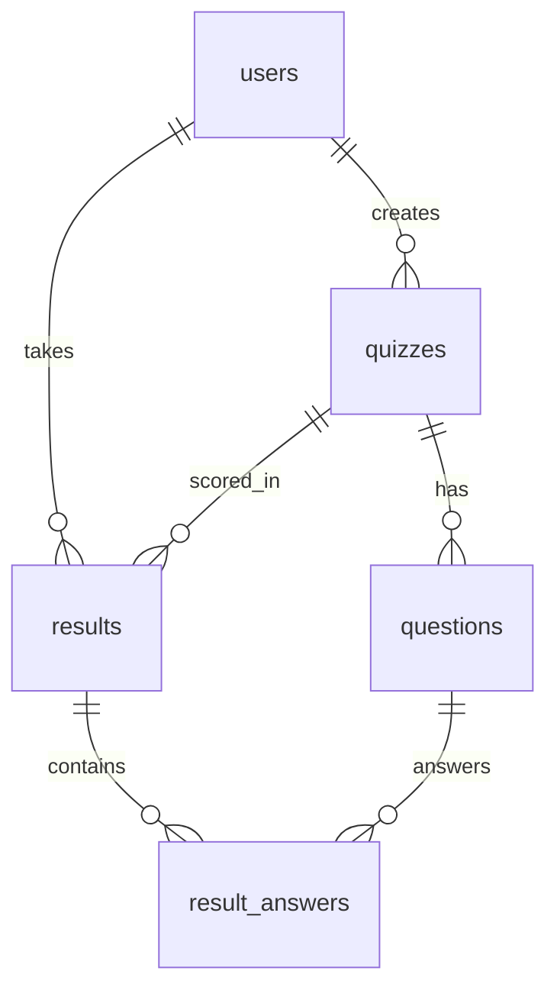

========== FILE: pom.xml ==========
<project xmlns="http://maven.apache.org/POM/4.0.0" xmlns:xsi="http://www.w3.org/2001/XMLSchema-instance" xsi:schemaLocation="http://maven.apache.org/POM/4.0.0 http://maven.apache.org/xsd/maven-4.0.0.xsd">
  <modelVersion>4.0.0</modelVersion>
  <groupId>com.quiz</groupId><artifactId>online-quiz-platform</artifactId><version>1.0</version><packaging>war</packaging>
  <properties><maven.compiler.source>11</maven.compiler.source><maven.compiler.target>11</maven.compiler.target><project.build.sourceEncoding>UTF-8</project.build.sourceEncoding></properties>
  <dependencies>
    <dependency><groupId>javax.servlet</groupId><artifactId>javax.servlet-api</artifactId><version>4.0.1</version><scope>provided</scope></dependency>
    <dependency><groupId>javax.servlet.jsp</groupId><artifactId>javax.servlet.jsp-api</artifactId><version>2.3.3</version><scope>provided</scope></dependency>
    <dependency><groupId>javax.servlet</groupId><artifactId>jstl</artifactId><version>1.2</version></dependency>
    <dependency><groupId>com.mysql</groupId><artifactId>mysql-connector-j</artifactId><version>8.0.33</version></dependency>
    <dependency><groupId>junit</groupId><artifactId>junit</artifactId><version>4.13.2</version><scope>test</scope></dependency>
  </dependencies>
  <build><finalName>quiz</finalName><plugins>
    <plugin><groupId>org.apache.maven.plugins</groupId><artifactId>maven-war-plugin</artifactId><version>3.3.2</version><configuration><failOnMissingWebXml>false</failOnMissingWebXml></configuration></plugin>
  </plugins></build>
</project>

========== FILE: .gitignore ==========
target/
.idea/
*.iml
.classpath
.project
.settings/

========== FILE: README.md ==========
# Java-Based Online Quiz Platform

GUVI × HCL Hackathon · Java Web Based Project · **Team Leader: Arpit Kumar** (arpit.25scse1011248@galgotiasuniversity.ac.in)

A web application where quiz creators publish timed multiple-choice quizzes on Java programming, participants take them and get instant scores plus detailed reports, and admins oversee users, quizzes and system settings.

## Problem understanding and solution design
| Problem | Solution |
|---|---|
| Practising Java needs timed, scored quizzes | Quizzes with a time limit (JS countdown + server-side check) and instant scoring |
| Learners need feedback | Per-question report (your answer vs correct) and attempt history |
| Content must be managed | Quiz Creator role for CRUD on quizzes and questions |
| Platform needs governance | Admin role: enable/disable/delete users, change roles, registration switch, publish/delete any quiz |

**Architecture (MVC + DAO):** Browser → Servlet (Controller) → DAO (JDBC) → MySQL; the Servlet forwards model data to a JSP (View).



## Marking rubric mapping (Java Web Based Projects)
| Rubric item | Where in the code |
|---|---|
| Problem Understanding and Solution Design | This README, `schema.sql`, role-based MVC design |
| Core Java Concepts | **Inheritance:** `User` → `Admin`/`QuizCreator`/`Participant`; `RoleServlet` → 3 servlets · **Polymorphism:** overridden `getDashboardPath()` · **Encapsulation:** private fields + getters/setters in `model/` · **Interfaces:** `CrudDAO<T>`, `RowMapper<T>` · **Generics and Collections:** `CrudDAO<T>`, `List`, `Map`, `LinkedHashMap`, `ConcurrentHashMap` · **Exception handling:** custom `AppException`, handled centrally in `RoleServlet` · **Multithreading and synchronization:** `AnalyticsService` (single-thread `ExecutorService`), `synchronized` `QuizStats`, `ConcurrentHashMap` |
| Database Integration (JDBC) | `DBUtil`, `BaseDAO` (PreparedStatement, try-with-resources), `UserDAO`, `QuizDAO`, `QuestionDAO`, `ResultDAO` (transaction with commit/rollback), `SettingDAO` |
| Servlets and Web Integration | `AuthServlet`, `AdminServlet`, `CreatorServlet`, `ParticipantServlet`; HttpSession login, role checks, form handling, JSP + JSTL views |

## Project structure
```
src/main/java/com/quiz/{model,dao,servlet,service,util,exception}
src/main/webapp/{login.jsp, css, js, WEB-INF/views/*.jsp}
src/main/resources/db.properties      src/test/java/com/quiz/CoreTest.java
schema.sql
```

## Run it
1. Install JDK 11+, Maven, MySQL 8 and **Apache Tomcat 9** (the code uses `javax.*`; Tomcat 10 will not work).
2. Run `schema.sql` in MySQL.
3. Set your MySQL password in `src/main/resources/db.properties`.
4. `mvn clean package` (runs the unit tests), copy `target/quiz.war` into Tomcat `webapps/`, start Tomcat, open http://localhost:8080/quiz (IDE: import as a Maven project in IntelliJ or Eclipse and run on Tomcat 9 with context path `/quiz`.)

Demo logins: `admin@quiz.com / admin123` · `creator@quiz.com / creator123` · register a Participant on the login page.

## Security notes
Passwords are SHA-256 hashed (BCrypt with salt is the recommended upgrade); all SQL uses PreparedStatements; JSP output is escaped with `<c:out>`; pages are guarded by role checks.

========== FILE: schema.sql ==========
CREATE DATABASE IF NOT EXISTS quiz_db; USE quiz_db;
CREATE TABLE users(id INT AUTO_INCREMENT PRIMARY KEY, name VARCHAR(80) NOT NULL, email VARCHAR(120) NOT NULL UNIQUE,
  password CHAR(64) NOT NULL, role ENUM('ADMIN','CREATOR','PARTICIPANT') NOT NULL DEFAULT 'PARTICIPANT', active BOOLEAN NOT NULL DEFAULT TRUE);
CREATE TABLE quizzes(id INT AUTO_INCREMENT PRIMARY KEY, title VARCHAR(150) NOT NULL, description TEXT, time_limit_min INT NOT NULL DEFAULT 10,
  creator_id INT NOT NULL, published BOOLEAN NOT NULL DEFAULT FALSE, FOREIGN KEY(creator_id) REFERENCES users(id) ON DELETE CASCADE);
CREATE TABLE questions(id INT AUTO_INCREMENT PRIMARY KEY, quiz_id INT NOT NULL, text VARCHAR(500) NOT NULL,
  option_a VARCHAR(255) NOT NULL, option_b VARCHAR(255) NOT NULL, option_c VARCHAR(255) NOT NULL, option_d VARCHAR(255) NOT NULL,
  correct CHAR(1) NOT NULL, FOREIGN KEY(quiz_id) REFERENCES quizzes(id) ON DELETE CASCADE);
CREATE TABLE results(id INT AUTO_INCREMENT PRIMARY KEY, user_id INT NOT NULL, quiz_id INT NOT NULL, score INT NOT NULL, total INT NOT NULL,
  taken_at TIMESTAMP DEFAULT CURRENT_TIMESTAMP, FOREIGN KEY(user_id) REFERENCES users(id) ON DELETE CASCADE, FOREIGN KEY(quiz_id) REFERENCES quizzes(id) ON DELETE CASCADE);
CREATE TABLE result_answers(id INT AUTO_INCREMENT PRIMARY KEY, result_id INT NOT NULL, question_id INT NOT NULL, chosen CHAR(1) NOT NULL,
  FOREIGN KEY(result_id) REFERENCES results(id) ON DELETE CASCADE, FOREIGN KEY(question_id) REFERENCES questions(id) ON DELETE CASCADE);
CREATE TABLE settings(k VARCHAR(50) PRIMARY KEY, v VARCHAR(100) NOT NULL);
INSERT INTO settings VALUES('registration_open','true');
-- Seed logins: admin@quiz.com / admin123, creator@quiz.com / creator123
INSERT INTO users(name,email,password,role) VALUES('Admin','admin@quiz.com','240be518fabd2724ddb6f04eeb1da5967448d7e831c08c8fa822809f74c720a9','ADMIN'),('Demo Creator','creator@quiz.com','756bf2effa2464565bab831d15a6a12d0fb1e7701294480c379b17f9c1064d0d','CREATOR');
INSERT INTO quizzes(title,description,time_limit_min,creator_id,published) VALUES('Java Basics','Core Java fundamentals',5,2,TRUE);
INSERT INTO questions(quiz_id,text,option_a,option_b,option_c,option_d,correct) VALUES
(1,'Which keyword is used for inheritance in Java?','implements','extends','inherits','super','B'),
(1,'Which is NOT a primitive type?','int','boolean','String','char','C'),
(1,'Method overriding is an example of?','Compile-time polymorphism','Runtime polymorphism','Encapsulation','Abstraction only','B'),
(1,'Which interface does ArrayList implement?','Map','Set','List','Queue','C');

========== FILE: src/main/resources/db.properties ==========
url=jdbc:mysql://localhost:3306/quiz_db?useSSL=false&allowPublicKeyRetrieval=true&serverTimezone=UTC
user=root
password=your_mysql_password

========== FILE: src/main/java/com/quiz/exception/AppException.java ==========
package com.quiz.exception;
/** Custom unchecked exception wrapping DB / validation failures. */
public class AppException extends RuntimeException {
    public AppException(String msg) { super(msg); }
    public AppException(String msg, Throwable cause) { super(msg, cause); }
}

========== FILE: src/main/java/com/quiz/util/DBUtil.java ==========
package com.quiz.util;
import com.quiz.exception.AppException;
import java.io.InputStream;
import java.sql.*;
import java.util.Properties;
/** JDBC connection utility; reads settings from db.properties. */
public final class DBUtil {
    private static final Properties P = new Properties();
    static {
        try (InputStream in = DBUtil.class.getClassLoader().getResourceAsStream("db.properties")) {
            P.load(in); Class.forName("com.mysql.cj.jdbc.Driver");
        } catch (Exception e) { throw new ExceptionInInitializerError(e); }
    }
    private DBUtil() {}
    public static Connection get() {
        try { return DriverManager.getConnection(P.getProperty("url"), P.getProperty("user"), P.getProperty("password")); }
        catch (SQLException e) { throw new AppException("Database connection failed: " + e.getMessage(), e); }
    }
}

========== FILE: src/main/java/com/quiz/util/PasswordUtil.java ==========
package com.quiz.util;
import java.security.MessageDigest;
public final class PasswordUtil {
    private PasswordUtil() {}
    public static String sha256(String s) {
        try {
            StringBuilder sb = new StringBuilder();
            for (byte b : MessageDigest.getInstance("SHA-256").digest(s.getBytes("UTF-8"))) sb.append(String.format("%02x", b));
            return sb.toString();
        } catch (Exception e) { throw new IllegalStateException(e); }
    }
}

========== FILE: src/main/java/com/quiz/model/Admin.java ==========
package com.quiz.model;
public class Admin extends User {
    public Admin(int id, String name, String email, boolean active) { super(id, name, email, "ADMIN", active); }
    @Override public String getDashboardPath() { return "/admin"; }
}

========== FILE: src/main/java/com/quiz/model/Participant.java ==========
package com.quiz.model;
public class Participant extends User {
    public Participant(int id, String name, String email, boolean active) { super(id, name, email, "PARTICIPANT", active); }
    @Override public String getDashboardPath() { return "/participant"; }
}

========== FILE: src/main/java/com/quiz/model/Question.java ==========
package com.quiz.model;
import java.util.LinkedHashMap;
import java.util.Map;
public class Question {
    private int id, quizId; private String text, a, b, c, d, correct, chosen;
    public Map<String, String> getOptions() { Map<String, String> m = new LinkedHashMap<>(); m.put("A", a); m.put("B", b); m.put("C", c); m.put("D", d); return m; }
    public void setOptions(String a, String b, String c, String d) { this.a = a; this.b = b; this.c = c; this.d = d; }
    public int getId() { return id; } public void setId(int v) { id = v; }
    public int getQuizId() { return quizId; } public void setQuizId(int v) { quizId = v; }
    public String getText() { return text; } public void setText(String v) { text = v; }
    public String getCorrect() { return correct; } public void setCorrect(String v) { correct = v; }
    public String getChosen() { return chosen; } public void setChosen(String v) { chosen = v; }
    public boolean isRight() { return correct != null && correct.equals(chosen); }
}

========== FILE: src/main/java/com/quiz/model/Quiz.java ==========
package com.quiz.model;
public class Quiz {
    private int id, timeLimitMin, creatorId, questionCount; private String title, description, creatorName; private boolean published;
    public int getId() { return id; } public void setId(int v) { id = v; }
    public String getTitle() { return title; } public void setTitle(String v) { title = v; }
    public String getDescription() { return description; } public void setDescription(String v) { description = v; }
    public int getTimeLimitMin() { return timeLimitMin; } public void setTimeLimitMin(int v) { timeLimitMin = v; }
    public int getCreatorId() { return creatorId; } public void setCreatorId(int v) { creatorId = v; }
    public String getCreatorName() { return creatorName; } public void setCreatorName(String v) { creatorName = v; }
    public int getQuestionCount() { return questionCount; } public void setQuestionCount(int v) { questionCount = v; }
    public boolean isPublished() { return published; } public void setPublished(boolean v) { published = v; }
}

========== FILE: src/main/java/com/quiz/model/QuizCreator.java ==========
package com.quiz.model;
public class QuizCreator extends User {
    public QuizCreator(int id, String name, String email, boolean active) { super(id, name, email, "CREATOR", active); }
    @Override public String getDashboardPath() { return "/creator"; }
}

========== FILE: src/main/java/com/quiz/model/Result.java ==========
package com.quiz.model;
import java.sql.Timestamp;
public class Result {
    private int id, userId, quizId, score, total; private String quizTitle; private Timestamp takenAt;
    public int getId() { return id; } public void setId(int v) { id = v; }
    public int getUserId() { return userId; } public void setUserId(int v) { userId = v; }
    public int getQuizId() { return quizId; } public void setQuizId(int v) { quizId = v; }
    public int getScore() { return score; } public void setScore(int v) { score = v; }
    public int getTotal() { return total; } public void setTotal(int v) { total = v; }
    public String getQuizTitle() { return quizTitle; } public void setQuizTitle(String v) { quizTitle = v; }
    public Timestamp getTakenAt() { return takenAt; } public void setTakenAt(Timestamp v) { takenAt = v; }
    public double getPercentage() { return total == 0 ? 0 : score * 100.0 / total; }
}

========== FILE: src/main/java/com/quiz/model/User.java ==========
package com.quiz.model;
/** Base user (encapsulation). Subclasses override getDashboardPath() => polymorphism. */
public class User {
    private int id; private String name, email, role; private boolean active = true;
    public User() {}
    public User(int id, String name, String email, String role, boolean active) { this.id = id; this.name = name; this.email = email; this.role = role; this.active = active; }
    public String getDashboardPath() { return "/login.jsp"; }
    public static User create(int id, String n, String e, String role, boolean a) {
        switch (role) {
            case "ADMIN": return new Admin(id, n, e, a);
            case "CREATOR": return new QuizCreator(id, n, e, a);
            default: return new Participant(id, n, e, a);
        }
    }
    public int getId() { return id; } public String getName() { return name; } public String getEmail() { return email; }
    public String getRole() { return role; } public boolean isActive() { return active; }
}

========== FILE: src/main/java/com/quiz/dao/BaseDAO.java ==========
package com.quiz.dao;
import com.quiz.exception.AppException;
import com.quiz.util.DBUtil;
import java.sql.*;
import java.util.*;
/** Shared JDBC plumbing (try-with-resources, prepared statements, exception translation). */
public abstract class BaseDAO {
    @FunctionalInterface public interface RowMapper<T> { T map(ResultSet r) throws SQLException; }
    protected <T> List<T> query(String sql, RowMapper<T> m, Object... a) {
        try (Connection c = DBUtil.get(); PreparedStatement p = c.prepareStatement(sql)) {
            bind(p, a);
            try (ResultSet r = p.executeQuery()) { List<T> l = new ArrayList<>(); while (r.next()) l.add(m.map(r)); return l; }
        } catch (SQLException e) { throw new AppException("Query failed: " + e.getMessage(), e); }
    }
    protected <T> T one(String sql, RowMapper<T> m, Object... a) { List<T> l = query(sql, m, a); return l.isEmpty() ? null : l.get(0); }
    protected int update(String sql, Object... a) {
        try (Connection c = DBUtil.get(); PreparedStatement p = c.prepareStatement(sql, Statement.RETURN_GENERATED_KEYS)) {
            bind(p, a); p.executeUpdate();
            try (ResultSet k = p.getGeneratedKeys()) { return k.next() ? k.getInt(1) : 0; }
        } catch (SQLException e) { throw new AppException("Update failed: " + e.getMessage(), e); }
    }
    private void bind(PreparedStatement p, Object[] a) throws SQLException { for (int i = 0; i < a.length; i++) p.setObject(i + 1, a[i]); }
}

========== FILE: src/main/java/com/quiz/dao/CrudDAO.java ==========
package com.quiz.dao;
import java.util.List;
public interface CrudDAO<T> { T findById(int id); List<T> findAll(); void delete(int id); }

========== FILE: src/main/java/com/quiz/dao/QuestionDAO.java ==========
package com.quiz.dao;
import com.quiz.model.Question;
import java.sql.*;
import java.util.List;
public class QuestionDAO extends BaseDAO implements CrudDAO<Question> {
    public static Question map(ResultSet r) throws SQLException {
        Question q = new Question(); q.setId(r.getInt("id")); q.setQuizId(r.getInt("quiz_id")); q.setText(r.getString("text"));
        q.setOptions(r.getString("option_a"), r.getString("option_b"), r.getString("option_c"), r.getString("option_d")); q.setCorrect(r.getString("correct")); return q;
    }
    public void add(Question q) {
        java.util.Iterator<String> o = q.getOptions().values().iterator();
        update("INSERT INTO questions(quiz_id,text,option_a,option_b,option_c,option_d,correct) VALUES(?,?,?,?,?,?,?)", q.getQuizId(), q.getText(), o.next(), o.next(), o.next(), o.next(), q.getCorrect());
    }
    public List<Question> findByQuiz(int quizId) { return query("SELECT * FROM questions WHERE quiz_id=? ORDER BY id", QuestionDAO::map, quizId); }
    @Override public Question findById(int id) { return one("SELECT * FROM questions WHERE id=?", QuestionDAO::map, id); }
    @Override public List<Question> findAll() { return query("SELECT * FROM questions", QuestionDAO::map); }
    @Override public void delete(int id) { update("DELETE FROM questions WHERE id=?", id); }
}

========== FILE: src/main/java/com/quiz/dao/QuizDAO.java ==========
package com.quiz.dao;
import com.quiz.model.Quiz;
import java.util.List;
public class QuizDAO extends BaseDAO implements CrudDAO<Quiz> {
    private static final String SEL = "SELECT z.*, u.name AS creator, (SELECT COUNT(*) FROM questions WHERE quiz_id=z.id) AS qc FROM quizzes z JOIN users u ON u.id=z.creator_id ";
    private static final RowMapper<Quiz> MAP = r -> {
        Quiz z = new Quiz(); z.setId(r.getInt("id")); z.setTitle(r.getString("title")); z.setDescription(r.getString("description"));
        z.setTimeLimitMin(r.getInt("time_limit_min")); z.setCreatorId(r.getInt("creator_id")); z.setCreatorName(r.getString("creator"));
        z.setQuestionCount(r.getInt("qc")); z.setPublished(r.getBoolean("published")); return z;
    };
    public int create(Quiz z) { return update("INSERT INTO quizzes(title,description,time_limit_min,creator_id) VALUES(?,?,?,?)", z.getTitle(), z.getDescription(), z.getTimeLimitMin(), z.getCreatorId()); }
    public void updateQuiz(Quiz z) { update("UPDATE quizzes SET title=?,description=?,time_limit_min=? WHERE id=?", z.getTitle(), z.getDescription(), z.getTimeLimitMin(), z.getId()); }
    public void setPublished(int id, boolean p) { update("UPDATE quizzes SET published=? WHERE id=?", p, id); }
    @Override public Quiz findById(int id) { return one(SEL + "WHERE z.id=?", MAP, id); }
    @Override public List<Quiz> findAll() { return query(SEL + "ORDER BY z.id DESC", MAP); }
    public List<Quiz> findByCreator(int uid) { return query(SEL + "WHERE z.creator_id=? ORDER BY z.id DESC", MAP, uid); }
    public List<Quiz> findPublished() { return query(SEL + "WHERE z.published=TRUE ORDER BY z.id DESC", MAP); }
    @Override public void delete(int id) { update("DELETE FROM quizzes WHERE id=?", id); }
}

========== FILE: src/main/java/com/quiz/dao/ResultDAO.java ==========
package com.quiz.dao;
import com.quiz.exception.AppException;
import com.quiz.model.*;
import com.quiz.util.DBUtil;
import java.sql.*;
import java.util.*;
public class ResultDAO extends BaseDAO {
    private static final String SEL = "SELECT r.*, z.title FROM results r JOIN quizzes z ON z.id=r.quiz_id ";
    private static final RowMapper<Result> MAP = r -> {
        Result x = new Result(); x.setId(r.getInt("id")); x.setUserId(r.getInt("user_id")); x.setQuizId(r.getInt("quiz_id"));
        x.setScore(r.getInt("score")); x.setTotal(r.getInt("total")); x.setQuizTitle(r.getString("title")); x.setTakenAt(r.getTimestamp("taken_at")); return x;
    };
    /** Saves result + per-question answers in one transaction. */
    public int save(Result res, Map<Integer, String> answers) {
        try (Connection c = DBUtil.get()) {
            c.setAutoCommit(false);
            try {
                int id;
                try (PreparedStatement p = c.prepareStatement("INSERT INTO results(user_id,quiz_id,score,total) VALUES(?,?,?,?)", Statement.RETURN_GENERATED_KEYS)) {
                    p.setInt(1, res.getUserId()); p.setInt(2, res.getQuizId()); p.setInt(3, res.getScore()); p.setInt(4, res.getTotal()); p.executeUpdate();
                    try (ResultSet k = p.getGeneratedKeys()) { k.next(); id = k.getInt(1); }
                }
                try (PreparedStatement p = c.prepareStatement("INSERT INTO result_answers(result_id,question_id,chosen) VALUES(?,?,?)")) {
                    for (Map.Entry<Integer, String> e : answers.entrySet()) { p.setInt(1, id); p.setInt(2, e.getKey()); p.setString(3, e.getValue()); p.addBatch(); }
                    p.executeBatch();
                }
                c.commit(); return id;
            } catch (SQLException e) { c.rollback(); throw e; }
        } catch (SQLException e) { throw new AppException("Could not save result: " + e.getMessage(), e); }
    }
    public Result findById(int id) { return one(SEL + "WHERE r.id=?", MAP, id); }
    public List<Result> findByUser(int uid) { return query(SEL + "WHERE r.user_id=? ORDER BY r.taken_at DESC", MAP, uid); }
    public List<Question> findDetails(int resultId) {
        return query("SELECT q.*, a.chosen FROM result_answers a JOIN questions q ON q.id=a.question_id WHERE a.result_id=? ORDER BY q.id",
                r -> { Question q = QuestionDAO.map(r); q.setChosen(r.getString("chosen")); return q; }, resultId);
    }
}

========== FILE: src/main/java/com/quiz/dao/SettingDAO.java ==========
package com.quiz.dao;
public class SettingDAO extends BaseDAO {
    public String get(String k, String def) { String v = one("SELECT v FROM settings WHERE k=?", r -> r.getString(1), k); return v == null ? def : v; }
    public void set(String k, String v) { update("INSERT INTO settings(k,v) VALUES(?,?) ON DUPLICATE KEY UPDATE v=?", k, v, v); }
}

========== FILE: src/main/java/com/quiz/dao/UserDAO.java ==========
package com.quiz.dao;
import com.quiz.model.User;
import java.util.List;
public class UserDAO extends BaseDAO implements CrudDAO<User> {
    private static final RowMapper<User> MAP = r -> User.create(r.getInt("id"), r.getString("name"), r.getString("email"), r.getString("role"), r.getBoolean("active"));
    public User authenticate(String email, String hash) { return one("SELECT * FROM users WHERE email=? AND password=?", MAP, email, hash); }
    public User findByEmail(String email) { return one("SELECT * FROM users WHERE email=?", MAP, email); }
    public int create(String name, String email, String hash, String role) { return update("INSERT INTO users(name,email,password,role) VALUES(?,?,?,?)", name, email, hash, role); }
    @Override public User findById(int id) { return one("SELECT * FROM users WHERE id=?", MAP, id); }
    @Override public List<User> findAll() { return query("SELECT * FROM users ORDER BY id", MAP); }
    @Override public void delete(int id) { update("DELETE FROM users WHERE id=?", id); }
    public void setActive(int id, boolean a) { update("UPDATE users SET active=? WHERE id=?", a, id); }
    public void setRole(int id, String role) { update("UPDATE users SET role=? WHERE id=?", role, id); }
}

========== FILE: src/main/java/com/quiz/service/AnalyticsService.java ==========
package com.quiz.service;
import com.quiz.model.Result;
import java.util.*;
import java.util.concurrent.*;
/** Singleton that updates live quiz statistics on a background worker thread (multithreading + synchronization). */
public final class AnalyticsService {
    private static final AnalyticsService INSTANCE = new AnalyticsService();
    private final ConcurrentMap<Integer, QuizStats> stats = new ConcurrentHashMap<>();
    private final ExecutorService pool = Executors.newSingleThreadExecutor(r -> { Thread t = new Thread(r, "analytics-worker"); t.setDaemon(true); return t; });
    private AnalyticsService() {}
    public static AnalyticsService getInstance() { return INSTANCE; }
    public void recordAsync(Result r) { pool.submit(() -> stats.computeIfAbsent(r.getQuizId(), k -> new QuizStats()).add(r.getPercentage())); }
    public Map<Integer, QuizStats> snapshot() { return Collections.unmodifiableMap(new HashMap<>(stats)); }
    public void shutdown() { pool.shutdown(); }
}

========== FILE: src/main/java/com/quiz/service/AppListener.java ==========
package com.quiz.service;
import javax.servlet.*;
import javax.servlet.annotation.WebListener;
/** Stops the analytics worker when the web app is undeployed. */
@WebListener
public class AppListener implements ServletContextListener {
    @Override public void contextDestroyed(ServletContextEvent e) { AnalyticsService.getInstance().shutdown(); }
}

========== FILE: src/main/java/com/quiz/service/QuizStats.java ==========
package com.quiz.service;
/** Thread-safe attempt counter; all access is synchronized on the instance. */
public class QuizStats {
    private int attempts; private long totalPercent;
    public synchronized void add(double percent) { attempts++; totalPercent += Math.round(percent); }
    public synchronized int getAttempts() { return attempts; }
    public synchronized double getAveragePercent() { return attempts == 0 ? 0 : (double) totalPercent / attempts; }
}

========== FILE: src/main/java/com/quiz/servlet/AdminServlet.java ==========
package com.quiz.servlet;
import com.quiz.dao.*;
import com.quiz.service.AnalyticsService;
import java.io.IOException;
import javax.servlet.ServletException;
import javax.servlet.annotation.WebServlet;
import javax.servlet.http.*;
@WebServlet("/admin")
public class AdminServlet extends RoleServlet {
    private final UserDAO users = new UserDAO(); private final QuizDAO quizzes = new QuizDAO(); private final SettingDAO settings = new SettingDAO();
    @Override protected String role() { return "ADMIN"; }
    @Override protected void doGet(HttpServletRequest rq, HttpServletResponse rs) throws ServletException, IOException {
        rq.setAttribute("users", users.findAll()); rq.setAttribute("quizzes", quizzes.findAll());
        rq.setAttribute("stats", AnalyticsService.getInstance().snapshot());
        rq.setAttribute("regOpen", "true".equals(settings.get("registration_open", "true")));
        forward(rq, rs, "admin");
    }
    @Override protected void doPost(HttpServletRequest rq, HttpServletResponse rs) throws IOException {
        String a = rq.getParameter("action");
        switch (a == null ? "" : a) {
            case "toggleUser": if (num(rq, "id") != user(rq).getId()) users.setActive(num(rq, "id"), "true".equals(rq.getParameter("active"))); break;
            case "setRole": if (num(rq, "id") != user(rq).getId()) users.setRole(num(rq, "id"), rq.getParameter("role")); break;
            case "deleteUser": if (num(rq, "id") != user(rq).getId()) users.delete(num(rq, "id")); break;
            case "deleteQuiz": quizzes.delete(num(rq, "id")); break;
            case "togglePublish": quizzes.setPublished(num(rq, "id"), "true".equals(rq.getParameter("published"))); break;
            case "settings": settings.set("registration_open", rq.getParameter("regOpen") != null ? "true" : "false"); break;
            default: break;
        }
        rs.sendRedirect(rq.getContextPath() + "/admin");
    }
}

========== FILE: src/main/java/com/quiz/servlet/AuthServlet.java ==========
package com.quiz.servlet;
import com.quiz.dao.*;
import com.quiz.exception.AppException;
import com.quiz.model.User;
import com.quiz.util.PasswordUtil;
import java.io.IOException;
import java.net.URLEncoder;
import javax.servlet.annotation.WebServlet;
import javax.servlet.http.*;
@WebServlet("/auth")
public class AuthServlet extends HttpServlet {
    private final UserDAO users = new UserDAO(); private final SettingDAO settings = new SettingDAO();
    @Override protected void doGet(HttpServletRequest rq, HttpServletResponse rs) throws IOException {
        HttpSession s = rq.getSession(false); if (s != null) s.invalidate();
        rs.sendRedirect(rq.getContextPath() + "/login.jsp?msg=You+have+been+logged+out");
    }
    @Override protected void doPost(HttpServletRequest rq, HttpServletResponse rs) throws IOException {
        String ctx = rq.getContextPath();
        try {
            String email = rq.getParameter("email").trim().toLowerCase(), pw = rq.getParameter("password");
            if ("register".equals(rq.getParameter("action"))) {
                String name = rq.getParameter("name").trim(), role = "CREATOR".equals(rq.getParameter("role")) ? "CREATOR" : "PARTICIPANT";
                if (!"true".equals(settings.get("registration_open", "true"))) throw new AppException("Registration is currently closed");
                if (name.isEmpty() || !email.matches("^[\\w.+-]+@[\\w-]+(\\.[\\w-]+)+$")) throw new AppException("Enter a valid name and email");
                if (pw.length() < 6) throw new AppException("Password must be at least 6 characters");
                if (users.findByEmail(email) != null) throw new AppException("That email is already registered");
                users.create(name, email, PasswordUtil.sha256(pw), role);
                rs.sendRedirect(ctx + "/login.jsp?msg=Account+created.+Please+log+in"); return;
            }
            User u = users.authenticate(email, PasswordUtil.sha256(pw));
            if (u == null || !u.isActive()) throw new AppException(u == null ? "Wrong email or password" : "Your account is disabled");
            rq.getSession().setAttribute("user", u);
            rs.sendRedirect(ctx + u.getDashboardPath());
        } catch (AppException | NullPointerException e) {
            String m = e instanceof AppException ? e.getMessage() : "Please fill in all fields";
            rs.sendRedirect(ctx + "/login.jsp?err=" + URLEncoder.encode(m, "UTF-8"));
        }
    }
}

========== FILE: src/main/java/com/quiz/servlet/CreatorServlet.java ==========
package com.quiz.servlet;
import com.quiz.dao.*;
import com.quiz.exception.AppException;
import com.quiz.model.*;
import java.io.IOException;
import javax.servlet.ServletException;
import javax.servlet.annotation.WebServlet;
import javax.servlet.http.*;
@WebServlet("/creator")
public class CreatorServlet extends RoleServlet {
    private final QuizDAO quizzes = new QuizDAO(); private final QuestionDAO questions = new QuestionDAO();
    @Override protected String role() { return "CREATOR"; }
    private Quiz owned(HttpServletRequest rq, int id) {
        Quiz z = quizzes.findById(id);
        if (z == null || z.getCreatorId() != user(rq).getId()) throw new AppException("Quiz not found or not yours");
        return z;
    }
    @Override protected void doGet(HttpServletRequest rq, HttpServletResponse rs) throws ServletException, IOException {
        if (rq.getParameter("quizId") != null) {
            Quiz z = owned(rq, num(rq, "quizId")); rq.setAttribute("quiz", z); rq.setAttribute("questions", questions.findByQuiz(z.getId()));
        }
        rq.setAttribute("quizzes", quizzes.findByCreator(user(rq).getId()));
        forward(rq, rs, "creator");
    }
    @Override protected void doPost(HttpServletRequest rq, HttpServletResponse rs) throws IOException {
        String a = rq.getParameter("action"), to = "/creator";
        if ("createQuiz".equals(a) || "updateQuiz".equals(a)) {
            Quiz z = new Quiz(); z.setTitle(rq.getParameter("title").trim()); z.setDescription(rq.getParameter("description"));
            z.setTimeLimitMin(Math.max(1, num(rq, "timeLimit"))); z.setCreatorId(user(rq).getId());
            if (z.getTitle().isEmpty()) throw new AppException("Title is required");
            if ("createQuiz".equals(a)) to += "?quizId=" + quizzes.create(z);
            else { z.setId(owned(rq, num(rq, "quizId")).getId()); quizzes.updateQuiz(z); to += "?quizId=" + z.getId(); }
        } else if ("deleteQuiz".equals(a)) quizzes.delete(owned(rq, num(rq, "quizId")).getId());
        else if ("togglePublish".equals(a)) { int id = owned(rq, num(rq, "quizId")).getId(); quizzes.setPublished(id, "true".equals(rq.getParameter("published"))); }
        else if ("addQuestion".equals(a)) {
            Question q = new Question(); q.setQuizId(owned(rq, num(rq, "quizId")).getId()); q.setText(rq.getParameter("text").trim());
            q.setOptions(rq.getParameter("a"), rq.getParameter("b"), rq.getParameter("c"), rq.getParameter("d")); q.setCorrect(rq.getParameter("correct"));
            questions.add(q); to += "?quizId=" + q.getQuizId();
        } else if ("deleteQuestion".equals(a)) {
            int qid = num(rq, "questionId"); Question q = questions.findById(qid);
            if (q != null) { owned(rq, q.getQuizId()); questions.delete(qid); to += "?quizId=" + q.getQuizId(); }
        }
        rs.sendRedirect(rq.getContextPath() + to);
    }
}

========== FILE: src/main/java/com/quiz/servlet/ParticipantServlet.java ==========
package com.quiz.servlet;
import com.quiz.dao.*;
import com.quiz.model.*;
import com.quiz.service.AnalyticsService;
import java.io.IOException;
import java.util.*;
import javax.servlet.ServletException;
import javax.servlet.annotation.WebServlet;
import javax.servlet.http.*;
@WebServlet("/participant")
public class ParticipantServlet extends RoleServlet {
    private final QuizDAO quizzes = new QuizDAO(); private final QuestionDAO questions = new QuestionDAO(); private final ResultDAO results = new ResultDAO();
    @Override protected String role() { return "PARTICIPANT"; }
    @Override protected void doGet(HttpServletRequest rq, HttpServletResponse rs) throws ServletException, IOException {
        String a = rq.getParameter("action"), home = rq.getContextPath() + "/participant";
        if ("start".equals(a)) {
            int id = num(rq, "quizId"); Quiz z = quizzes.findById(id); List<Question> l = questions.findByQuiz(id);
            if (z == null || !z.isPublished() || l.isEmpty()) { rs.sendRedirect(home); return; }
            rq.getSession().setAttribute("start_" + id, System.currentTimeMillis());  // server-side timer start
            rq.setAttribute("quiz", z); rq.setAttribute("questions", l); forward(rq, rs, "quiz");
        } else if ("report".equals(a)) {
            Result r = results.findById(num(rq, "resultId"));
            if (r == null || r.getUserId() != user(rq).getId()) { rs.sendRedirect(home); return; }
            rq.setAttribute("result", r); rq.setAttribute("details", results.findDetails(r.getId())); forward(rq, rs, "result");
        } else {
            rq.setAttribute("quizzes", quizzes.findPublished()); rq.setAttribute("history", results.findByUser(user(rq).getId())); forward(rq, rs, "participant");
        }
    }
    @Override protected void doPost(HttpServletRequest rq, HttpServletResponse rs) throws IOException {
        int id = num(rq, "quizId"); Long start = (Long) rq.getSession().getAttribute("start_" + id); Quiz z = quizzes.findById(id);
        if (start == null || z == null) { rs.sendRedirect(rq.getContextPath() + "/participant"); return; }
        boolean late = System.currentTimeMillis() - start > (z.getTimeLimitMin() * 60L + 15) * 1000;  // 15s grace
        rq.getSession().removeAttribute("start_" + id);
        List<Question> l = questions.findByQuiz(id); Map<Integer, String> ans = new LinkedHashMap<>(); int score = 0;
        for (Question q : l) {
            String c = late ? null : rq.getParameter("q" + q.getId()); if (c == null) c = "-";
            ans.put(q.getId(), c); if (c.equals(q.getCorrect())) score++;
        }
        Result r = new Result(); r.setUserId(user(rq).getId()); r.setQuizId(id); r.setScore(score); r.setTotal(l.size());
        int rid = results.save(r, ans);
        AnalyticsService.getInstance().recordAsync(r);  // updated on a background thread
        rs.sendRedirect(rq.getContextPath() + "/participant?action=report&resultId=" + rid);
    }
}

========== FILE: src/main/java/com/quiz/servlet/RoleServlet.java ==========
package com.quiz.servlet;
import com.quiz.exception.AppException;
import com.quiz.model.User;
import java.io.IOException;
import javax.servlet.ServletException;
import javax.servlet.http.*;
/** Base controller: session-based auth + role check + central error handling. */
public abstract class RoleServlet extends HttpServlet {
    protected abstract String role();
    @Override protected void service(HttpServletRequest rq, HttpServletResponse rs) throws ServletException, IOException {
        HttpSession s = rq.getSession(false);
        User u = s == null ? null : (User) s.getAttribute("user");
        if (u == null || !role().equals(u.getRole())) { rs.sendRedirect(rq.getContextPath() + "/login.jsp?err=Please+log+in+first"); return; }
        try { super.service(rq, rs); }
        catch (AppException | NumberFormatException e) { rq.setAttribute("error", e.getMessage()); forward(rq, rs, "error"); }
    }
    protected User user(HttpServletRequest rq) { return (User) rq.getSession().getAttribute("user"); }
    protected void forward(HttpServletRequest rq, HttpServletResponse rs, String view) throws ServletException, IOException {
        rq.getRequestDispatcher("/WEB-INF/views/" + view + ".jsp").forward(rq, rs);
    }
    protected int num(HttpServletRequest rq, String name) { return Integer.parseInt(rq.getParameter(name)); }
}

========== FILE: src/test/java/com/quiz/CoreTest.java ==========
package com.quiz;
import static org.junit.Assert.*;
import com.quiz.model.*;
import com.quiz.service.QuizStats;
import com.quiz.util.PasswordUtil;
import java.util.concurrent.*;
import org.junit.Test;
public class CoreTest {
    @Test public void passwordHashIsStable() {
        assertEquals(64, PasswordUtil.sha256("admin123").length());
        assertEquals(PasswordUtil.sha256("abc"), PasswordUtil.sha256("abc"));
        assertNotEquals(PasswordUtil.sha256("abc"), PasswordUtil.sha256("abd"));
    }
    @Test public void polymorphicDashboards() {
        assertEquals("/admin", User.create(1, "a", "a@x.com", "ADMIN", true).getDashboardPath());
        assertEquals("/creator", User.create(2, "c", "c@x.com", "CREATOR", true).getDashboardPath());
        assertEquals("/participant", User.create(3, "p", "p@x.com", "PARTICIPANT", true).getDashboardPath());
    }
    @Test public void quizStatsIsThreadSafe() throws Exception {
        QuizStats s = new QuizStats(); ExecutorService ex = Executors.newFixedThreadPool(8);
        for (int t = 0; t < 8; t++) ex.submit(() -> { for (int i = 0; i < 1000; i++) s.add(50); });
        ex.shutdown(); assertTrue(ex.awaitTermination(10, TimeUnit.SECONDS));
        assertEquals(8000, s.getAttempts()); assertEquals(50.0, s.getAveragePercent(), 0.001);
    }
}

========== FILE: src/main/webapp/index.jsp ==========
<% response.sendRedirect(request.getContextPath() + "/login.jsp"); %>

========== FILE: src/main/webapp/login.jsp ==========
<%@ taglib prefix="c" uri="http://java.sun.com/jsp/jstl/core" %>
<jsp:include page="/WEB-INF/views/_header.jsp"><jsp:param name="title" value="Log in"/></jsp:include>
<c:if test="${not empty param.err}"><p class="err"><c:out value="${param.err}"/></p></c:if>
<c:if test="${not empty param.msg}"><p class="ok"><c:out value="${param.msg}"/></p></c:if>
<div class="grid2">
<form class="card" method="post" action="${pageContext.request.contextPath}/auth"><h2>Log in</h2>
 <input type="hidden" name="action" value="login">
 <label>Email<input type="email" name="email" required></label>
 <label>Password<input type="password" name="password" required></label>
 <button class="btn">Log in</button></form>
<form class="card" method="post" action="${pageContext.request.contextPath}/auth" onsubmit="return checkPw(this)"><h2>Create account</h2>
 <input type="hidden" name="action" value="register">
 <label>Name<input name="name" required></label>
 <label>Email<input type="email" name="email" required></label>
 <label>Password (6+ characters)<input type="password" name="password" minlength="6" required></label>
 <label>I want to<select name="role"><option value="PARTICIPANT">Take quizzes</option><option value="CREATOR">Create quizzes</option></select></label>
 <button class="btn">Register</button></form></div>
<script src="${pageContext.request.contextPath}/js/app.js"></script>
<jsp:include page="/WEB-INF/views/_footer.jsp"/>

========== FILE: src/main/webapp/css/style.css ==========
:root{--ink:#14213d;--paper:#f5f6f8;--card:#fff;--teal:#0f766e;--amber:#f2b134;--red:#b42318;--line:#d9dde3}
*{box-sizing:border-box}body{margin:0;font:16px/1.5 Georgia,'Times New Roman',serif;background:var(--paper);color:var(--ink)}
h1,h2,h3,.btn,.brand,table,label,.timer{font-family:'Trebuchet MS',Verdana,sans-serif}
.top{display:flex;justify-content:space-between;align-items:center;padding:.8rem 1.5rem;background:var(--ink);color:#fff}
.brand{color:var(--amber);font-weight:700;font-size:1.3rem;text-decoration:none}.top nav{display:flex;gap:1rem;align-items:center}.top a{color:#fff}
main{max-width:1000px;margin:1.5rem auto;padding:0 1rem}.grid2{display:grid;grid-template-columns:repeat(auto-fit,minmax(300px,1fr));gap:1rem;align-items:start}
.card{background:var(--card);border:1px solid var(--line);border-radius:6px;padding:1rem 1.2rem;margin-bottom:1rem}.card.sel{border-color:var(--teal);border-width:2px}
.row{display:flex;justify-content:space-between;align-items:center;gap:1rem;flex-wrap:wrap}
label{display:block;margin:.6rem 0;font-weight:600}input,select,textarea{display:block;width:100%;padding:.5rem;margin-top:.25rem;border:1px solid var(--line);border-radius:4px;font:inherit}
.chk input{display:inline;width:auto}.inline{display:inline-flex;gap:.5rem;align-items:center;flex-wrap:wrap;margin:0}.inline select{width:auto;margin:0}
.btn{display:inline-block;background:var(--teal);color:#fff;border:0;border-radius:4px;padding:.6rem 1.1rem;font-weight:700;cursor:pointer;text-decoration:none}
.btn:hover{background:#0b5a54}.btn.sm{padding:.3rem .7rem;font-size:.85rem}.btn.danger{background:var(--red)}
.btn:focus-visible,input:focus-visible,select:focus-visible,textarea:focus-visible{outline:3px solid var(--amber);outline-offset:2px}
.scroll{overflow-x:auto}table{width:100%;border-collapse:collapse;background:#fff}th,td{padding:.55rem .7rem;border-bottom:1px solid var(--line);text-align:left}th{background:#eaeef3}
.err{background:#fde8e6;color:var(--red);padding:.6rem 1rem;border-radius:4px}.ok{background:#e0f4ee;color:var(--teal);padding:.6rem 1rem;border-radius:4px}
.timer{position:sticky;top:0;float:right;background:var(--ink);color:var(--amber);font-size:1.6rem;padding:.4rem 1rem;border-radius:0 0 6px 6px;z-index:5}.timer.low{background:var(--red);color:#fff}
.opt{font-weight:400;display:flex;gap:.5rem;align-items:center;padding:.4rem;border-radius:4px;cursor:pointer}.opt input{width:auto;margin:0}.opt:hover{background:#eef6f5}
fieldset{border:1px solid var(--line)}.right{color:var(--teal);font-weight:700}.score{text-align:center}.score h1{font-size:3rem;margin:.2rem}
.good{border-left:6px solid var(--teal)}.bad{border-left:6px solid var(--red)}
@media(max-width:600px){.top{flex-direction:column;gap:.4rem}}@media(prefers-reduced-motion:reduce){*{transition:none!important}}

========== FILE: src/main/webapp/js/app.js ==========
function checkPw(f){ if(f.password.value.length<6){alert('Password must be at least 6 characters');return false;} return true; }
(function(){
  var t=document.getElementById('timer'); if(!t) return;
  var done=false, left=parseInt(t.dataset.seconds,10), form=document.getElementById('quizForm');
  function tick(){ if(done) return;
    var m=Math.floor(left/60), s=left%60; t.textContent=(m<10?'0':'')+m+':'+(s<10?'0':'')+s;
    if(left<=30) t.classList.add('low');
    if(left<=0){ form.submit(); return; }
    left--; setTimeout(tick,1000);
  }
  form.addEventListener('submit',function(){ done=true; }); tick();
})();

========== FILE: src/main/webapp/WEB-INF/views/_footer.jsp ==========
</main></body></html>

========== FILE: src/main/webapp/WEB-INF/views/_header.jsp ==========
<%@ taglib prefix="c" uri="http://java.sun.com/jsp/jstl/core" %>
<c:set var="ctx" value="${pageContext.request.contextPath}"/>
<!DOCTYPE html><html lang="en"><head><meta charset="UTF-8"><meta name="viewport" content="width=device-width, initial-scale=1">
<title>${param.title} · JavaQuiz</title><link rel="stylesheet" href="${ctx}/css/style.css"></head><body>
<header class="top"><a class="brand" href="${ctx}/">JavaQuiz</a>
<c:if test="${not empty sessionScope.user}"><nav><span><c:out value="${sessionScope.user.name}"/> (${sessionScope.user.role})</span><a href="${ctx}/auth">Log out</a></nav></c:if></header><main>

========== FILE: src/main/webapp/WEB-INF/views/admin.jsp ==========
<%@ taglib prefix="c" uri="http://java.sun.com/jsp/jstl/core" %><%@ taglib prefix="fmt" uri="http://java.sun.com/jsp/jstl/fmt" %>
<jsp:include page="_header.jsp"><jsp:param name="title" value="Admin"/></jsp:include>
<h1>Admin dashboard</h1>
<form class="card inline" method="post" action="${ctx}/admin"><input type="hidden" name="action" value="settings">
 <label class="chk"><input type="checkbox" name="regOpen" ${regOpen ? 'checked' : ''}> Allow new registrations</label><button class="btn">Save setting</button></form>
<h2>Users</h2><div class="scroll"><table><tr><th>Name</th><th>Email</th><th>Role</th><th>Status</th><th></th></tr>
<c:forEach var="u" items="${users}"><tr><td><c:out value="${u.name}"/></td><td><c:out value="${u.email}"/></td>
<td><form method="post" action="${ctx}/admin" class="inline"><input type="hidden" name="action" value="setRole"><input type="hidden" name="id" value="${u.id}">
 <select name="role" onchange="this.form.submit()"><c:forEach var="r" items="ADMIN,CREATOR,PARTICIPANT"><option ${u.role == r ? 'selected' : ''}>${r}</option></c:forEach></select></form></td>
<td>${u.active ? 'Active' : 'Disabled'}</td>
<td><c:if test="${u.id != sessionScope.user.id}"><form method="post" action="${ctx}/admin" class="inline"><input type="hidden" name="id" value="${u.id}">
 <button class="btn sm" name="action" value="toggleUser" onclick="this.form.insertAdjacentHTML('beforeend','<input type=hidden name=active value=${!u.active}>')">${u.active ? 'Disable' : 'Enable'}</button>
 <button class="btn sm danger" name="action" value="deleteUser" onclick="return confirm('Delete this user and their results?')">Delete</button></form></c:if></td></tr></c:forEach></table></div>
<h2>All quizzes</h2><div class="scroll"><table><tr><th>Title</th><th>Creator</th><th>Questions</th><th>Minutes</th><th>Attempts*</th><th>Avg %*</th><th>Status</th><th></th></tr>
<c:forEach var="z" items="${quizzes}"><tr><td><c:out value="${z.title}"/></td><td><c:out value="${z.creatorName}"/></td><td>${z.questionCount}</td><td>${z.timeLimitMin}</td><td>${empty stats[z.id] ? 0 : stats[z.id].attempts}</td><td><fmt:formatNumber value="${empty stats[z.id] ? 0 : stats[z.id].averagePercent}" maxFractionDigits="0"/>%</td><td>${z.published ? 'Published' : 'Draft'}</td>
<td><form method="post" action="${ctx}/admin" class="inline"><input type="hidden" name="id" value="${z.id}"><input type="hidden" name="published" value="${!z.published}">
 <button class="btn sm" name="action" value="togglePublish">${z.published ? 'Unpublish' : 'Publish'}</button>
 <button class="btn sm danger" name="action" value="deleteQuiz" onclick="return confirm('Delete this quiz?')">Delete</button></form></td></tr></c:forEach></table></div>
<p><small>* Live statistics since the server started, computed on a background thread.</small></p>
<jsp:include page="_footer.jsp"/>

========== FILE: src/main/webapp/WEB-INF/views/creator.jsp ==========
<%@ taglib prefix="c" uri="http://java.sun.com/jsp/jstl/core" %>
<jsp:include page="_header.jsp"><jsp:param name="title" value="Creator"/></jsp:include>
<h1>Your quizzes</h1>
<div class="grid2"><div>
<c:forEach var="z" items="${quizzes}"><div class="card ${quiz.id == z.id ? 'sel' : ''}"><h3><c:out value="${z.title}"/></h3>
 <p>${z.questionCount} questions · ${z.timeLimitMin} min · ${z.published ? 'Published' : 'Draft'}</p>
 <form method="post" action="${ctx}/creator" class="inline"><input type="hidden" name="quizId" value="${z.id}"><input type="hidden" name="published" value="${!z.published}">
 <a class="btn sm" href="${ctx}/creator?quizId=${z.id}">Edit</a>
 <button class="btn sm" name="action" value="togglePublish">${z.published ? 'Unpublish' : 'Publish'}</button>
 <button class="btn sm danger" name="action" value="deleteQuiz" onclick="return confirm('Delete this quiz?')">Delete</button></form></div></c:forEach>
<c:if test="${empty quizzes}"><p>No quizzes yet. Create your first one.</p></c:if></div>
<form class="card" method="post" action="${ctx}/creator">
 <c:choose><c:when test="${not empty quiz}"><h2>Edit quiz</h2><input type="hidden" name="action" value="updateQuiz"><input type="hidden" name="quizId" value="${quiz.id}"></c:when>
 <c:otherwise><h2>New quiz</h2><input type="hidden" name="action" value="createQuiz"></c:otherwise></c:choose>
 <label>Title<input name="title" value="<c:out value='${quiz.title}'/>" required></label>
 <label>Description<textarea name="description"><c:out value="${quiz.description}"/></textarea></label>
 <label>Time limit (minutes)<input type="number" name="timeLimit" min="1" value="${empty quiz ? 10 : quiz.timeLimitMin}" required></label>
 <button class="btn">${empty quiz ? 'Create quiz' : 'Save changes'}</button></form></div>
<c:if test="${not empty quiz}"><h2>Questions in “<c:out value="${quiz.title}"/>”</h2>
<c:forEach var="q" items="${questions}"><div class="card"><strong><c:out value="${q.text}"/></strong>
 <ul><c:forEach var="o" items="${q.options}"><li class="${o.key == q.correct ? 'right' : ''}">${o.key}. <c:out value="${o.value}"/></li></c:forEach></ul>
 <form method="post" action="${ctx}/creator"><input type="hidden" name="action" value="deleteQuestion"><input type="hidden" name="questionId" value="${q.id}"><button class="btn sm danger">Delete question</button></form></div></c:forEach>
<form class="card" method="post" action="${ctx}/creator"><h3>Add a multiple-choice question</h3>
 <input type="hidden" name="action" value="addQuestion"><input type="hidden" name="quizId" value="${quiz.id}">
 <label>Question<input name="text" required></label>
 <label>Option A<input name="a" required></label><label>Option B<input name="b" required></label>
 <label>Option C<input name="c" required></label><label>Option D<input name="d" required></label>
 <label>Correct answer<select name="correct"><option>A</option><option>B</option><option>C</option><option>D</option></select></label>
 <button class="btn">Add question</button></form></c:if>
<jsp:include page="_footer.jsp"/>

========== FILE: src/main/webapp/WEB-INF/views/error.jsp ==========
<%@ page isErrorPage="true" %><jsp:include page="_header.jsp"><jsp:param name="title" value="Error"/></jsp:include>
<%@ taglib prefix="c" uri="http://java.sun.com/jsp/jstl/core" %>
<div class="card"><h2>Something went wrong</h2><p class="err"><c:out value="${error}"/></p><a class="btn" href="javascript:history.back()">Go back</a></div>
<jsp:include page="_footer.jsp"/>

========== FILE: src/main/webapp/WEB-INF/views/participant.jsp ==========
<%@ taglib prefix="c" uri="http://java.sun.com/jsp/jstl/core" %><%@ taglib prefix="fmt" uri="http://java.sun.com/jsp/jstl/fmt" %>
<jsp:include page="_header.jsp"><jsp:param name="title" value="Quizzes"/></jsp:include>
<h1>Available quizzes</h1>
<c:forEach var="z" items="${quizzes}"><div class="card row"><div><h3><c:out value="${z.title}"/></h3><p><c:out value="${z.description}"/></p>
 <small>${z.questionCount} questions · ${z.timeLimitMin} min · by <c:out value="${z.creatorName}"/></small></div>
 <a class="btn" href="${ctx}/participant?action=start&quizId=${z.id}" onclick="return confirm('The timer starts now. Ready?')">Start quiz</a></div></c:forEach>
<c:if test="${empty quizzes}"><p>No quizzes are published yet. Check back soon.</p></c:if>
<h2>Your history</h2>
<c:if test="${empty history}"><p>You haven't taken a quiz yet.</p></c:if>
<c:if test="${not empty history}"><div class="scroll"><table><tr><th>Quiz</th><th>Score</th><th>%</th><th>Taken</th><th></th></tr>
<c:forEach var="r" items="${history}"><tr><td><c:out value="${r.quizTitle}"/></td><td>${r.score}/${r.total}</td>
<td><fmt:formatNumber value="${r.percentage}" maxFractionDigits="0"/>%</td><td><fmt:formatDate value="${r.takenAt}" pattern="dd MMM yyyy, HH:mm"/></td>
<td><a class="btn sm" href="${ctx}/participant?action=report&resultId=${r.id}">Report</a></td></tr></c:forEach></table></div></c:if>
<jsp:include page="_footer.jsp"/>

========== FILE: src/main/webapp/WEB-INF/views/quiz.jsp ==========
<%@ taglib prefix="c" uri="http://java.sun.com/jsp/jstl/core" %>
<jsp:include page="_header.jsp"><jsp:param name="title" value="Quiz"/></jsp:include>
<div class="timer" id="timer" data-seconds="${quiz.timeLimitMin * 60}">--:--</div>
<h1><c:out value="${quiz.title}"/></h1>
<form id="quizForm" method="post" action="${ctx}/participant"><input type="hidden" name="quizId" value="${quiz.id}">
<c:forEach var="q" items="${questions}" varStatus="s"><fieldset class="card"><legend>Question ${s.count}</legend><p><c:out value="${q.text}"/></p>
 <c:forEach var="o" items="${q.options}"><label class="opt"><input type="radio" name="q${q.id}" value="${o.key}"> ${o.key}. <c:out value="${o.value}"/></label></c:forEach></fieldset></c:forEach>
<button class="btn">Submit answers</button></form>
<script src="${ctx}/js/app.js"></script>
<jsp:include page="_footer.jsp"/>

========== FILE: src/main/webapp/WEB-INF/views/result.jsp ==========
<%@ taglib prefix="c" uri="http://java.sun.com/jsp/jstl/core" %><%@ taglib prefix="fmt" uri="http://java.sun.com/jsp/jstl/fmt" %>
<jsp:include page="_header.jsp"><jsp:param name="title" value="Results"/></jsp:include>
<div class="card score"><h1>${result.score} / ${result.total}</h1><p><fmt:formatNumber value="${result.percentage}" maxFractionDigits="0"/>% on <c:out value="${result.quizTitle}"/></p></div>
<h2>Question review</h2>
<c:forEach var="q" items="${details}" varStatus="s"><div class="card ${q.right ? 'good' : 'bad'}"><strong>${s.count}. <c:out value="${q.text}"/></strong>
 <p>Your answer: ${q.chosen == '-' ? 'No answer' : q.chosen} · Correct: ${q.correct} (<c:out value="${q.options[q.correct]}"/>)</p></div></c:forEach>
<a class="btn" href="${ctx}/participant">Back to quizzes</a>
<jsp:include page="_footer.jsp"/>
